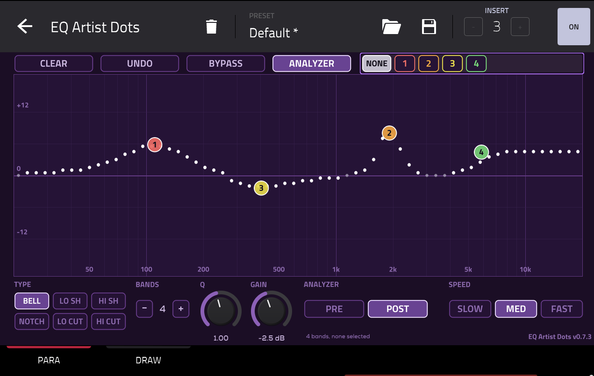

# EQ Artist

An 8-band EQ for the Akai MPC standalone (MPC OS 3.10.1+, insert effect) that you edit two ways, over a
live spectrum of the track:

- **PARA:** drag band nodes on the graph. Each band has its own colour. Dragging sets frequency and gain (a cut's
  resonance, a notch's depth); TYPE, Q and GAIN / SLOPE act on the selected band; − and + remove and add bands.
- **DRAW:** paint the curve you want with a finger. The sound follows the finger at once, and the drawing is
  fitted to the same bands.

Both pages edit one EQ: what you make on one shows on the other. The filters have zero latency and follow
their analog shapes, so high bands keep their width instead of narrowing towards 20 kHz. Every setting works with
the MPC's data wheel: touch it, and a ring shows which one the wheel edits.



It is built as two plugins from one codebase, with the same features:

| Plugin | Curves | Status |
|---|---|---|
| **EQ Artist Dots** | drawn as dots (the fewest screen widgets) | the one to use |
| **EQ Artist Lines** | drawn as connected lines | **experimental**: the screen updates far more slowly |

**Status: 1.0.0.** Tested on an MPC Live III (MPC OS 3.10.1). Controls: [docs/CONTROLS.md](docs/CONTROLS.md).
How the PARA page and the curve drawing were arrived at: [docs/PARA_STUDY.md](docs/PARA_STUDY.md) and
[CurveUITest/test-results/live3.md](CurveUITest/test-results/live3.md).

## Install

1. Download **eq-artist-dots-1.0.0-mpc.zip** (and, to try it, **eq-artist-lines-1.0.0-mpc.zip**) from the release
   and unzip it.
2. Copy the folder `Slow Ops - VST - EQ Artist Dots` (or `... Lines`) into a folder named `VST2 Plugins` at the top
   level of a USB drive, an SD card or the MPC's internal drive.
3. On the MPC (MPC OS 3.10.1 or later), open **Preferences → Enhancements (Beta)** and switch on
   **Enable Enhancements** and **External Plugin Support**.
4. Restart the MPC, then add **EQ Artist Dots** (Slow Ops, under External Plugins) as an insert on a track.

Parameter ids are permanent from 1.0, so projects saved with 1.0 keep working with later versions. Projects
saved with a 0.x build may not load their settings. A project saved with one plugin does not load into the other.

## Layout

| Path | What |
|---|---|
| `core/include/slowops/eqartist/` | Header-only DSP and curve encoding, standard library only: `Filters` (band shapes, analog-matched zero-latency biquads), `EqEngine` (8 bands, glides, click-free crossfades), `CurveFit` (drawing → bands), `FitWorker` (runs the fit off the audio thread), `LiveEq` (32 bells that follow the drawing while you draw), `Spectrum` + `Fft` (analyser), `LineStrip` (curves as film-strip columns, node hit-testing). |
| `plugin-common/` | The plugin, shared by both builds: `EqArtistPlugin.hpp` (parameters, DRAW, the display queue; takes a variant) and `ParaPage.hpp` (the PARA page). |
| `plugins/dots/`, `plugins/lines/` | The two SDK projects: `plugin.json`, a few-line `src/*.cpp` that picks the variant, and `skins/`. |
| `scripts/` | `build.sh`, `test.sh` (both plugins); `package.sh` (release zips), `release.sh` (catalog zips); `gen_skins.py` (TUI.json + Q-Links.json), `make_art.sh` and the art scripts (PNGs; text needs Pillow), `skin_layout.py` (shared layout and palette). The plugin to work on is chosen with `EQA_VARIANT=dots|lines`. |
| `tests/` | `core_tests.cpp` (DSP and curve encoding), `scenario_host.cpp` (drives each real plugin binary through the VST2 ABI: PARA edits and DRAW strokes against the measured audio). |
| `CurveUITest/` | A separate diagnostic plugin and its hardware results: what the MPC's skin widgets can and cannot do. |
| `docs/` | `CONTROLS.md`, `PARA_STUDY.md` (how the PARA page and the curve drawing were arrived at), `SPIKE.md` (the first drawing-surface test). |
| `assets/fonts/` | Titillium Web Bold (SIL OFL 1.1, see `OFL.txt`), drawn into the skin images. `knob_uni.png` in the skins is the SDK's UI-kit knob (MIT), rendered in purple. |
| `third_party/mpc-plugin-builder-sdk` | Official SDK as a git submodule, pinned to `febd2ca` (2026-11-07). |

## Build and test

```sh
git submodule update --init
./scripts/test.sh        # both plugins: build (native + arm32 + arm64), core tests, host_sim, scenario host
```

`scripts/package.sh` zips both built plugins into `dist/`. `scripts/release.sh` then makes the
[open-mpc catalog](https://open-mpc.github.io/workflow.html) zips, where EQ Artist Dots is listed as "EQ Artist"
(`EQ-Artist-<version>-mpc-armv7.zip` and `-mpc-aarch64.zip`) with the catalog's own tools, from a checkout of
`open-mpc/mpc-vst-plugins` beside this repo (or `MPC_CATALOG`), and checks them. Attach those zips to the GitHub release too.

On the first run, `build.py` installs Zig into `third_party/mpc-plugin-builder-sdk/.sdk-tools/` (about 50 MB).
The output folders are `plugins/dots/build/Slow Ops - VST - EQ Artist Dots/` and
`plugins/lines/build/Slow Ops - VST - EQ Artist Lines/`. Copy a folder into `VST2 Plugins/` at the root of a
drive the MPC can see, or install over the network with the SDK's `tools/mpc_remote.py`. The MPC needs
Preferences → Enhancements (Beta) → Enable Enhancements and External Plugin Support.

The skin images are committed. After changing `scripts/skin_layout.py`, run
`PILLOW_PY=/path/to/python-with-pillow scripts/make_art.sh`.

## Licence

MIT. The SDK is MIT-licensed by inMusic.
