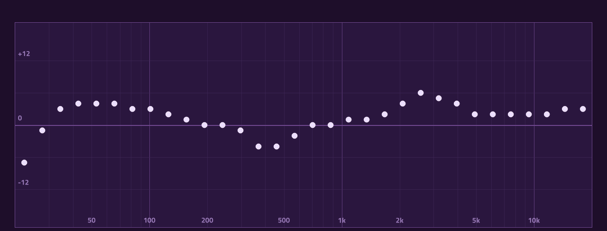
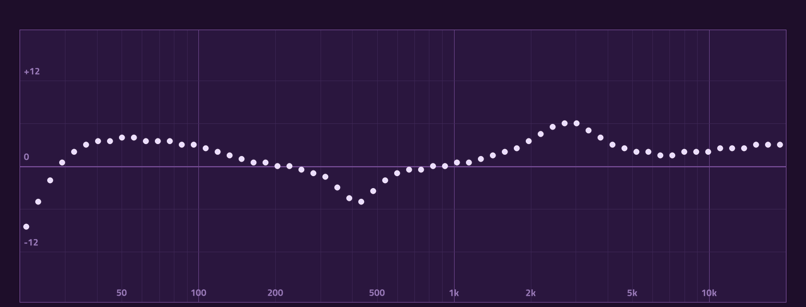
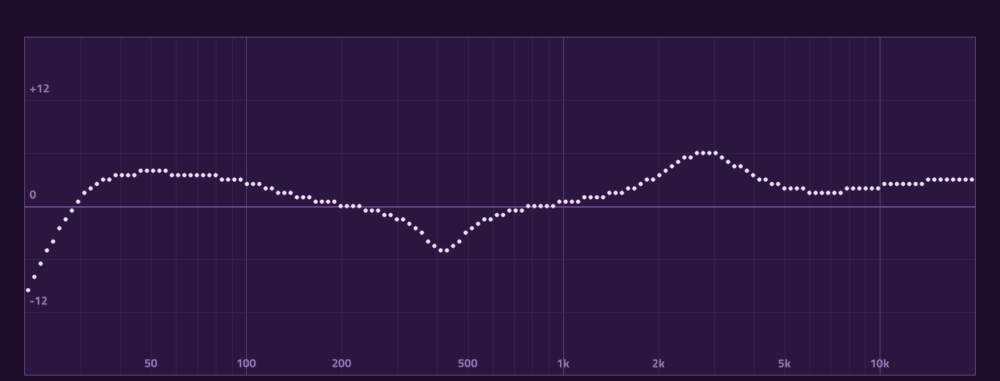
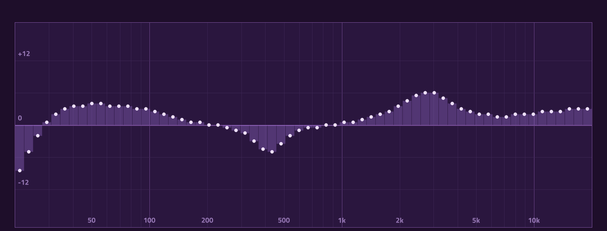
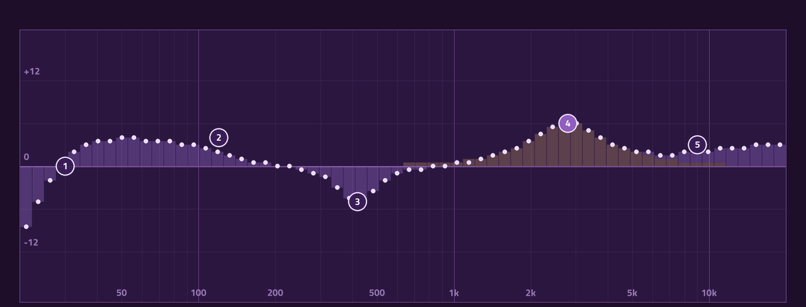

# PARA page study: what the MPC skin can draw for an interactive parametric EQ

The PARA tab exists but is empty. This note records what was tested offline (2026-11-14) before
designing it. The mock-ups are rendered at the real screen geometry from the real skin background, with an
example EQ: a 24 dB/oct low cut at 30 Hz, a +4 dB low shelf at 120 Hz, a −5 dB bell at 420 Hz (Q 2.2), a
+6 dB bell at 2.8 kHz (Q 1.2) and a +3 dB high shelf at 9 kHz.

## What the skin can and cannot do

- No canvas and no line drawing that follows values. The `Path` widget only draws a fixed path, and
  `Plotter` draws one value's history over time. So a curve is made of one film-strip image per column,
  each showing a dot (or a bar) at the height the plugin selects. The DRAW page already works this way.
- A touch pad (`XYPad`) over the whole graph works on the MPC (the pen on DRAW). Whether stacked pads
  pass touches to the ones underneath is **untested**. If they don't, only the top band node could be grabbed.
- Each moving dot is a parameter that the plugin updates. On the MPC, about 230 updates per second is
  fine (0.3.2 "NORMAL"); higher rates are untested.
- Film strips are tall images (frames stacked vertically). The current dot strip is 15,984 px, just under
  the 16,384 px texture limit common on embedded GPUs. Going past that limit is untested.

## Curve resolution

| Option | Columns | Step | Worst error shown | Look |
|---|---|---|---|---|
| A (DRAW today) | 32 | 1 dB | 0.49 dB |  |
| B | 64 | 0.5 dB | 0.24 dB |  |
| C | 152 | 0.5 dB | 0.25 dB |  |
| D | 64 + filled area | 0.5 dB | 0.24 dB |  |
| E (PARA mock) | 64 + fill + band nodes + selected band shaded | 0.5 dB | 0.24 dB |  |

- **32 columns is too coarse for a parametric page.** Peaks lose their shape, and narrow bands vanish: a
  Q 8 notch at 1 kHz shows only −2.0 dB, because no column centre lands in it. At 64 columns it shows
  −7.9 dB, and at 152 columns −10.7 dB. A fix that works at any resolution is to have each column show the
  extreme value across its own frequency span, not the value at its centre.
- **152 columns reads as a line**, but 0.5 dB steps (6 px) show as a staircase on flat runs.
- **Vertical resolution is limited by strip height.** 0.5 dB steps need 73 frames, or 31,536 px at the full
  graph height. Splitting each column into an upper and a lower half (two widgets bound to the same
  parameter, each strip covering half the graph) brings that to 15,768 px. 0.25 dB steps would need
  quarters.

## Update load while dragging a band

A +6 dB bell (Q 1.2) is swept from 40 Hz to 20 kHz in one second, at 30 refreshes per second. These are
the curve columns that change per refresh:

| Columns, step | Average | Max | Behind with 8 / refresh | Behind with 24 / refresh |
|---|---|---|---|---|
| 32, 1 dB | 8.2 | 12 | 2 refreshes (66 ms) | 1 (33 ms) |
| 48, 1 dB | 12.8 | 15 | | |
| 64, 1 dB | 17.1 | 19 | | |
| 64, 0.5 dB | 21.7 | 26 | 4 (132 ms) | 2 (66 ms) |
| 152, 0.5 dB | 51.1 | 64 | 8 (264 ms) | 3 (99 ms) |

A curve that keeps up with a dragged node needs about 20–25 curve updates per refresh at 64 columns: up to
about 720 per second, three times the rate verified on the MPC. The spectrum can pause while a node is
held, to free the budget.

## Recommendation for the first PARA iteration

1. **64 columns, 0.5 dB, with a filled area under the curve** (option D/E): readable, fast enough to
   redraw, and strips within the limit using upper/lower halves. Each column shows its span's extreme so
   narrow notches stay visible.
2. **Band nodes drawn as display-only XYPads (numbered pucks) under one full-graph touch pad**, the
   proven pen setup. The plugin hit-tests the touch: touch down near a node to grab it, drag to move its
   frequency and gain. This avoids depending on stacked pads.
3. **Node positions in their own display parameters (Node n X / Y)**, which the plugin keeps in step with
   the band parameters. The pad's range then doesn't have to match the bands' ±24 dB gain range against the
   graph's ±18 dB.
4. **The selected band's own shape lightly shaded** (option E), and its Type / Q / Slope / On on a row of
   controls under the graph (switches and a knob, as on DRAW).
5. While a node is dragged: curve budget up to about 24 per refresh, spectrum paused. Then check on the
   MPC whether that rate stays smooth.

Open questions for the hardware: do stacked XYPads pass touches through, are film strips over 16,384 px
tall usable, and how many updates per second stay smooth?

## Built: PARA 0.5.0 (UI test, silent bands)

Built from the Curve UI Test results (`CurveUITest/test-results/live3.md`): one full-graph pen with
plugin-side hit-testing (stacked pads can't be separate nodes), display-only node XYPads, the connected line
(152 columns, 0.125 dB, 8,959-frame images 645,048 px tall: proven in K7d), and the selected band's shading
(64 columns per colour). 438 parameters, about 1,490 widgets on the tab. Desktop: 46/46 end-to-end checks,
a 2 s node drag sends about 330 line + shade updates per second (budget 480).

### Device checklist

| # | Check | Result | Notes |
|---|---|---|---|
| Q1 | Both tabs' corners read "EQ Artist v0.5.0"; PARA shows 2 coloured nodes on a smooth white line | | |
| Q2 | Touch near node 2 and drag: it follows without jumping; the status line updates | | |
| Q3 | Touch empty space: nothing moves | | |
| Q4 | Tap band buttons 1 / 2: the ring and the coloured shading move to that band | | |
| Q5 | BANDS up to 8: nodes and buttons 3–8 appear, each in its colour | | |
| Q6 | TYPE, Q and SLOPE change the selected band (the line and shading follow) | | |
| Q7 | Drag smoothness: does the line keep up? | | |
| Q8 | Opening the plugin / switching tabs: how long? Memory meter? | | |
| Q9 | DRAW still works, and PARA never changes the sound | | |

## 0.5.1: the selected band in front, the combined curve behind in grey, STYLE LINE | DOTS

Asked for on the MPC: only the selected band's curve in front (white, with a glow in its colour from its
shading), the combined curve behind it in grey at full detail, and a STYLE switch (LINE = the connected line,
DOTS = dots, the old "halves" look). Native Envelope widgets were tried first (Curve UI Test ENV / ENV2) and
cannot follow an EQ curve. Cost: a second 8,959-frame line image set (grey, about 124 MB, about 250 MB of line
images in all), 656 parameters, 2,664 widgets on PARA. While PARA curves catch up the display budget is 16 per
refresh (proven), otherwise 8.

| # | Check | Result | Notes |
|---|---|---|---|
| Q10 | Corners read v0.5.1; select each band: its white curve and colour glow, the grey combined curve behind | | |
| Q11 | STYLE DOTS / LINE: both curves switch | | |
| Q12 | Opening time and memory with about 250 MB of line images and 2,664 widgets | | |

## 0.5.2: PARA first, DOTS default, NONE, − / +

From the 0.5.1 screenshot: PARA is now the first tab (the plugin opens on it), STYLE reads DOTS | LINE with DOTS
the default, the band shading is one flat colour with the glow only on the outer side, **NONE** shows just the
combined curve (in white), and − / + replace the BANDS knob. Fixed: PARA had no background (grid, labels and
captions were missing: only the first tab got an image), the status line was cut off, and the band shading
images were empty (a loop-variable bug in make_para_art.py, caught in the mock render).

| # | Check | Result | Notes |
|---|---|---|---|
| Q13 | Opens on PARA (v0.5.2) with grid, labels and captions; DOTS selected | | |
| Q14 | NONE: only the combined curve, in white | | |
| Q15 | + adds a band and selects it; − removes the selected band | | |
| Q16 | The band shading is flat under the curve, the colour glow only above it (below it for a cut) | | |

## 0.5.3: a clean band fill

The 0.5.2 colour glow and fill came from 64-column shading, so on the MPC they showed as stepped blocks
around the smooth line ("the top gradient is all messed up"). Now: no glow; a flat fill at the line's
resolution (152 columns of 8 px, 0.25 dB), all eight colours in one film strip (frame = colour x height,
8 x 501,120 px, about 16 MB). It replaces the eight 64-column shading layers (PARA: 2,306 widgets, was 2,666).
While PARA redraws, the spectrum keeps 2 updates per refresh so it never freezes.

| # | Check | Result | Notes |
|---|---|---|---|
| Q17 | v0.5.3: the band fill is flat and follows the curve, no gradient or blocks above it, in DOTS and LINE | PASS (DOTS) | `images/para/Q17-fill-053.png`: band 1 at 888 Hz, -5.7 dB: flat coral fill under the cut, clean edge along the dots, grey combined dots through band 2, spectrum behind. Loaded without an app restart (re-adding the plugin was enough this time) |

## 0.5.4: smoother dragging, ANALYZER on PARA

On the MPC, dragging in DOTS was slow and in LINE a grabbed node did not move at all. Two causes:
- Every pen update recomputed every curve from scratch (about 320 µs on desktop, several times that on the
  MPC) on the audio thread. Now each band's response is cached on the curves' sample grids, only a changed
  band is re-sampled, and curves are recomputed at most 30 times a second: 11 µs per audio block while
  dragging (desktop).
- During a drag every curve was sent to the screen. In LINE a column is 6 image tiles, so the MPC's screen
  was swamped and the touch pad stopped responding. Now a drag sends only the nodes and the dragged band's
  own curve (12 per refresh in LINE, 16 in DOTS); the grey combined curve and the fill catch up when the
  finger stops.
ANALYZER (spectrum on/off, the same switch as DRAW's) is now in PARA's top row.

| # | Check | Result | Notes |
|---|---|---|---|
| Q18 | v0.5.4, LINE: grab and drag a node: it follows; the band's curve follows; grey curve and fill catch up after | | |
| Q19 | DOTS: dragging is smoother than 0.5.3 | | |
| Q20 | ANALYZER turns the spectrum on and off | | |

## 0.5.5 / 0.5.6: LINE dragging

On 0.5.4 a node dragged in DOTS but not in LINE: the first touch selected it, the drag updates never moved it,
while the rest of the page stayed responsive. Visible widgets: Curve UI Test's CURVE tab in LINE (~950) dragged
fine; PARA in DOTS (~500) dragged; PARA in LINE (~2,050: two 152-column lines of 6 tiles each, plus the fill)
did not. 0.5.5 cut the tiles to 3 per column (images 1,290,096 px tall, ~1,130 visible, not installed: still
"really slow" by your account of 0.5.4). 0.5.6 brings the line back to **76 columns** (LineStrip76: 16 px,
0.25 dB, 25 rises, 3,625 frames, 3 tiles of 144 px, images 522,000 px tall), and the fill to 76 columns:
**about 600 widgets visible in LINE, 863 on the whole page.** Peak-aware vertices keep narrow peaks reaching
their node.

| # | Check | Result | Notes |
|---|---|---|---|
| Q21 | v0.5.6, LINE: drag a node; smooth enough? | | |
| Q22 | DOTS: dragging speed | | |

## 0.6.0: PARA wired to the sound; two plugins

LINE dragging worked on the MPC at 76 columns (0.5.6: "Lines work"; the analyzer felt a bit slow, left for
later). 0.6.0 then:

- **One EQ.** PARA's silent test bands are gone: PARA edits the engine's eight bands, the same ones DRAW's
  fit writes. *Bands* is the count (bands 1 … count are on). A stroke on DRAW sets the bands and the count
  and clears the selection; a PARA edit redraws DRAW's drawing after 0.3 s. Both pages show the same
  "EQ you hear" curve, which shows the live EQ's response while a stroke sounds.
- **Two plugins from one codebase:** EQ Artist Dots (curves as 64 dot columns; PARA shows about 380 widgets)
  and EQ Artist Lines (curves as 76 line columns of 3 tiles; PARA shows about 590, the count that dragged
  well). The STYLE switch is gone. Code: `plugin-common/` plus two few-line projects in `plugins/`.
- Desktop: both pass 56 end-to-end checks each (a dragged node measures +6.00 dB where the node says +6).

| # | Check (each plugin) | Dots | Lines | Notes |
|---|---|---|---|---|
| R1 | The corner reads the plugin's name and v0.6.0 | | | |
| R2 | PARA: drag a node and hear the EQ change | | | |
| R3 | DRAW: draw a curve; PARA then shows nodes on it | | | |
| R4 | PARA edit, then DRAW: the drawing matches | | | |
| R5 | + / −, TYPE, Q, SLOPE, NONE, UNDO, CLEAR, BYPASS | | | |
| R6 | How dragging feels; opening time; memory | | | |

## 1.0.0

Released after the checks on the Live III (EQ Artist Dots, 0.7.3: the PARA page in
[images/para-page.png](images/para-page.png)). Between 0.6.0 and 1.0.0: DRAW's top row and analyzer settings on
PARA, the 3 x 2 TYPE grid, focus rings and the data wheel on every setting, one GAIN / SLOPE knob, a cut's node
height as its resonance and a notch's as its depth, UNDO for PARA edits, and one band count for both pages.
EQ Artist Lines ships as experimental: on the MPC its screen updates far more slowly than Dots.
